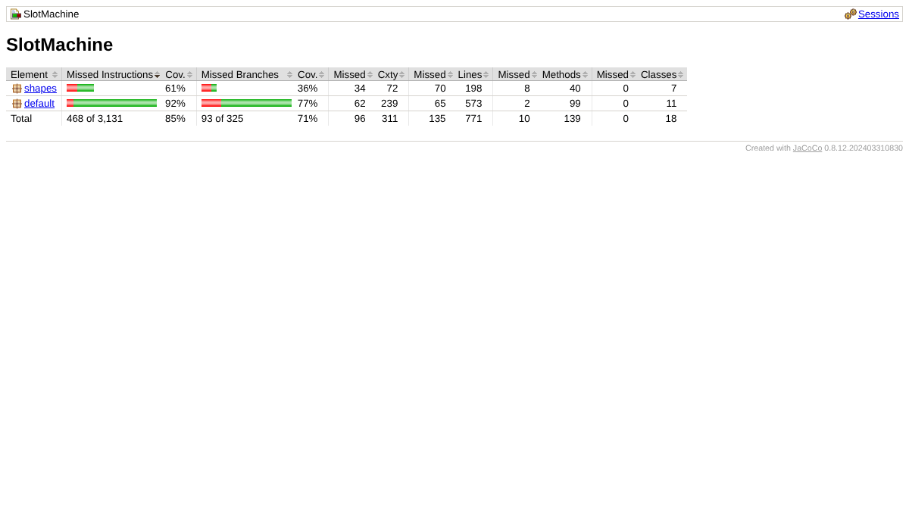
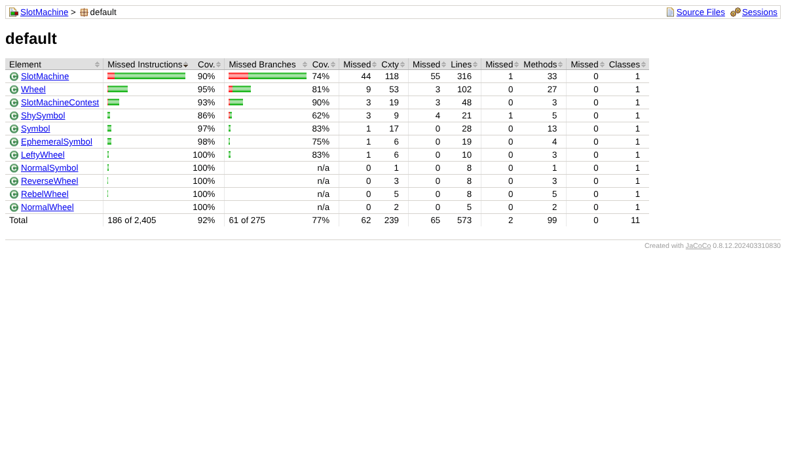
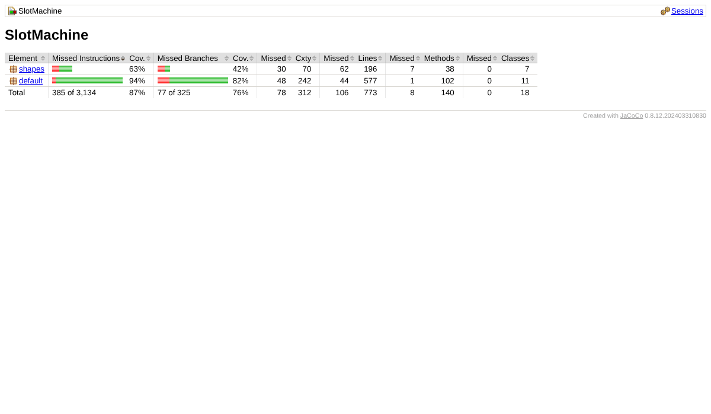

# 1. Qué se midió

Se midió el **cubrimiento de código** de las pruebas de unidad con **JaCoCo 0.8.12**, integrado en Maven (`pom.xml`).

- **Pruebas que cuentan:** `SlotMachineC1Test`, `C2Test`, `C3Test`, `C4Test`, `CC2Test`, `CC4Test`, `ContestTest` y `ContestCTest`.
- **Prueba que no cuenta:** `SlotMachineAcceptanceTest`. Necesita a una persona que mire la pantalla y responda, así que se ejecuta aparte desde VS Code.
- **Cómo se genera:** en VS Code, terminal, `mvn clean test`. El informe queda en `target/site/jacoco/index.html`.
- **Meta del enunciado:** más del **75 %** de cubrimiento de código.

# 2. Resultado inicial

Proyecto recién pasado a VS Code, sin ningún cambio. Se ejecutaron 73 pruebas y todas pasan.

| Medida | Cubrimiento |
|---|---|
| Instrucciones | **85,1 %** |
| Ramas (if / switch) | 71,4 % |
| Líneas | 82,5 % |
| Métodos | 92,8 % |

{width=95%}

{width=95%}

**Lo que se vio:**

1. La meta de instrucciones ya se cumplía, pero **las ramas estaban en 71,4 %**, por debajo del 75 %.
2. Faltaban dos clases de prueba que pide el enunciado: **`SlotMachineC1Test`** y **`SlotMachineC3Test`**.
3. En `SlotMachine` (90 %) no se probaban varios casos de error: borrar una rueda sin ruedas, borrar un color que no existe, repetir un color, `isJackpot()` con una rueda vacía, `SlotMachine(n)` con n fuera de 3..50 y `spin(wheel, steps)` con pasos negativos.
4. Lo menos cubierto está en `shapes` (`Shape`, `Circle`, `Triangle`). Son métodos que vienen del proyecto de ejemplo de BlueJ y el simulador no usa, como `moveRight()`, `moveUp()` o `slowMoveHorizontal()`.

# 3. Decisiones tomadas

| # | Decisión | Por qué |
|---|---|---|
| 1 | Crear **`SlotMachineC1Test`** (17 pruebas) | Lo pide la entrega. Cubre los requisitos 1 a 8: crear, agregar y eliminar ruedas y símbolos, girar, consultar, jackpot, visibilidad y terminar. Incluye los **casos de error** que no se probaban. |
| 2 | Crear **`SlotMachineC3Test`** (9 pruebas) | Lo pide la entrega. Cubre `SlotMachine(n)` (límites 3 y 50, n inválido, colores distintos), `spin(wheel, steps)` cíclico y con pasos negativos, y `distinctSymbols()`. |
| 3 | **No** escribir pruebas para los métodos de `shapes` que el simulador no usa | Probarlos solo subiría el número sin probar nada del simulador. Se dejan como están porque son parte de la librería `shapes` del curso. |
| 4 | **No** contar la prueba de aceptación | No es automática: depende de que una persona responda "Sí". |
| 5 | Ejecutar `simulate` con pantalla | `SlotMachineContestCTest` llama a `simulate(3)`, que abre el lienzo. En VS Code se ve la máquina y el aviso de JACKPOT, que hay que cerrar con **Aceptar**. |

# 4. Resultado final

Se ejecutaron 99 pruebas de unidad y todas pasan.

| Medida | Inicial | Final |
|---|---|---|
| Instrucciones | 85,1 % | **87,7 %** |
| Ramas | 71,4 % | **76,3 %** |
| Líneas | 82,5 % | **86,3 %** |
| Métodos | 92,8 % | **94,3 %** |

{width=95%}

{width=95%}

**Conclusión:** se cumple la meta. Las clases propias del simulador tienen **94 %** de cubrimiento de instrucciones y el proyecto completo **87,7 %**. Todas las medidas quedaron por encima del 75 %, incluidas las ramas.

> Nota: `SlotMachine(n)` y `spin()` son aleatorios. Por eso el porcentaje de `SlotMachineContest` puede variar uno o dos puntos entre una ejecución y otra.
