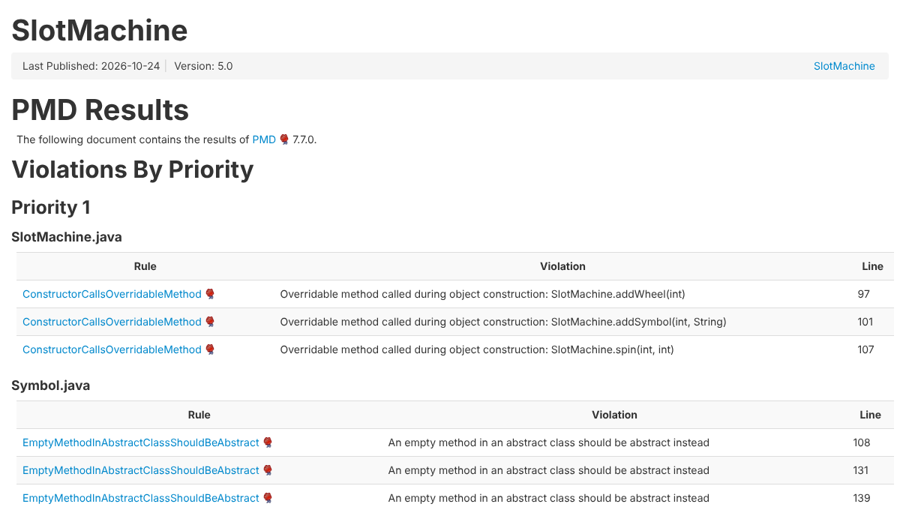
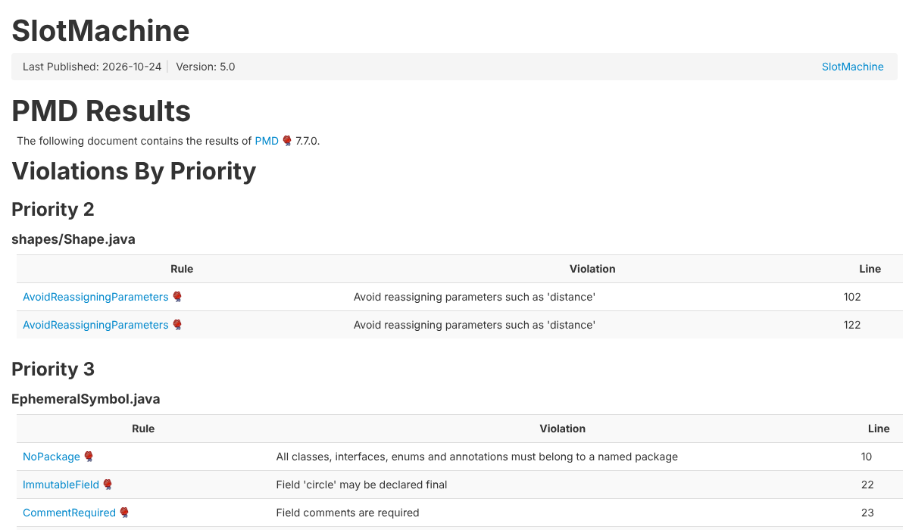

# 1. Qué se analizó

Se revisó el código fuente con **PMD 7.7.0**.

- **Reglas:** todas las categorías de reglas de Java que trae PMD: *bestpractices, codestyle, design, documentation, errorprone, multithreading, performance* y *security*.
- **Código analizado:** las 16 clases del simulador (`src/main/java`, incluido `shapes`).
- **Cómo se genera:** en la terminal de VS Code, con PMD descargado de pmd.github.io: `pmd check -d src/main/java -R <reglas> -f html -r pmd.html`, donde `<reglas>` son las 8 categorías de arriba separadas por coma (`category/java/bestpractices.xml,category/java/codestyle.xml,...`). El informe queda en `pmd.html`, con la prioridad de cada violación.
- **Meta del enunciado:** cumplir **todas las reglas de prioridad alta (rojo)**, que en PMD es la **prioridad 1**.

# 2. Resultado inicial

| Prioridad | Violaciones |
|---|---|
| **1 (alta, rojo)** | **11** |
| 2 | 2 |
| 3 | 420 |
| 4 | 1 |

{width=95%}

**Las 11 violaciones de prioridad 1:**

| Regla | Dónde | Qué significa |
|---|---|---|
| ConstructorCallsOverridableMethod (×3) | `SlotMachine(n)` | El constructor llama a `addWheel`, `addSymbol` y `spin`, y esos métodos se podrían redefinir en una subclase. |
| ConstructorCallsOverridableMethod (×1) | Constructor de `Wheel` | Llama a `styleMarker(...)`, que es abstracto. Corre antes de que la subclase termine de construirse. |
| EmptyMethodInAbstractClassShouldBeAbstract (×3) | `Symbol`: `setHidden`, `spun`, `selected` | Métodos vacíos en una clase abstracta: deberían ser abstractos. |
| ClassWithOnlyPrivateConstructorsShouldBeFinal (×2) | `Canvas` y su clase interna `CanvasPane` | Si nadie puede heredar de ellas, deben declararse `final`. |
| FieldNamingConventions (×2) | `Rectangle.EDGES`, `Triangle.VERTICES` | Son estáticos en mayúscula pero no `final`, así que no son constantes. |

# 3. Decisiones tomadas

| # | Regla | Decisión | Por qué |
|---|---|---|---|
| 1 | ConstructorCallsOverridableMethod en `SlotMachine` | Declarar la clase `public final class SlotMachine`. | Nadie hereda de `SlotMachine`. Con `final` sus métodos ya no se pueden redefinir y el constructor queda seguro, sin cambiar ningún método. |
| 2 | ConstructorCallsOverridableMethod en `Wheel` | La forma de la marca la pone la fábrica `Wheel.create(...)` y no el constructor: primero crea la rueda y después llama a `styleMarker(marker)`. | Así el método abstracto se llama cuando el objeto ya está construido. `SlotMachine` siempre crea las ruedas con `create(...)`, así que el comportamiento no cambia. |
| 3 | EmptyMethodInAbstractClassShouldBeAbstract en `Symbol` | `spun()`, `selected()` y `setHidden(...)` pasan a ser **abstractos**. Cada tipo de símbolo los implementa; los que no reaccionan los dejan vacíos, con un comentario que explica por qué. | Es más claro: cada tipo de símbolo dice explícitamente cómo reacciona al giro, a la selección y al esconderse. |
| 4 | ClassWithOnlyPrivateConstructorsShouldBeFinal | `Canvas` y `CanvasPane` pasan a `final`. | `Canvas` es un *singleton* (solo se obtiene con `getCanvas()`), así que no tiene sentido heredar de ella. |
| 5 | FieldNamingConventions | `EDGES` y `VERTICES` pasan a `static final`. | Son constantes: un rectángulo siempre tiene 4 lados y un triángulo 3. |
| 6 | Prioridades 2 a 4 | **No** se cambian en esta entrega. | La meta es la prioridad alta. La mayoría son de estilo (por ejemplo, poner `final` en cada parámetro o tener un solo `return` por método). Cambiarlas tocaría casi todo el código sin mejorar el diseño. |

Después de cada cambio se volvieron a ejecutar todas las pruebas de unidad (99) y siguen pasando.

**Cambios para el diagrama de Astah:**

- En `Symbol`, `spun()`, `selected()` y `setHidden(...)` quedan en cursiva (abstractos).
- `NormalSymbol`, `EphemeralSymbol` y `ShySymbol` muestran los métodos que ahora implementan.
- En el diagrama de secuencia de `addWheel(type, pos)`, `Wheel.create(...)` llama a `styleMarker(marker)` después de crear la rueda.

# 4. Resultado final

| Prioridad | Inicial | Final |
|---|---|---|
| **1 (alta, rojo)** | 11 | **0** |
| 2 | 2 | 2 |
| 3 | 420 | 402 |
| 4 | 1 | 1 |

{width=95%}

**Conclusión:** se cumple la meta. No queda **ninguna violación de prioridad alta**. Las de prioridad 3 también bajaron (de 420 a 402) como efecto de los mismos cambios: por ejemplo, ya no hay comentarios demasiado largos en la documentación de las clases (*CommentSize*), ni métodos vacíos sin comentario (*UncommentedEmptyMethodBody*), ni atributos estáticos que se puedan modificar (*MutableStaticState*).
